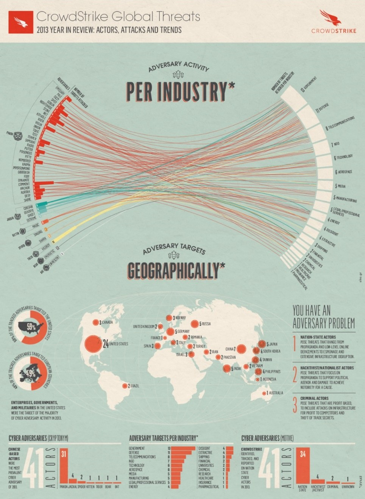

# CC-02 2013 年度回顾的连线版

课件第 36 页。图题或图中标识 *CrowdStrike Global Threats 2013 Year in Review*。

## 数据与信息组织

与环形版共用年度主题和底部地图统计，上方改为两侧类别与对应连线。

## 图形与视觉编码

弧形两端排列标签，彩色线连接与目标行业有关的记录，圆点和条长继续承担局部数量阅读。

## 阅读路径与复用

沿一端类别追踪对应行业，再回到底部核对计数。复用时先定义每条记录和交叉关系，避免把同一全年数重复累计。

[返回本组案例](README.md)
