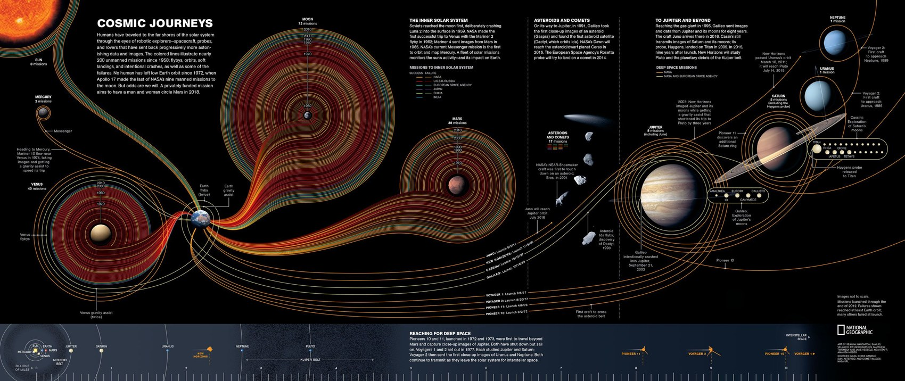

# CC-03 太阳系探测任务

课件第 37 页。图题或图中标识 *Cosmic Journeys*。

## 数据与信息组织

从地球发出的任务按目的天体聚集，月球、金星和火星等区域局部带有年代标记，还展示了深空任务的距离参照。

## 图形与视觉编码

彩线按图例区分任务归属及状态，年代标签定位局部轨道序列，行星图像帮助定位分类。

## 阅读路径与复用

可从年代追任务，也可从目的地反查资料。底部距离刻度有单独单位，原图说明天体图像本身采用示意尺度。

[返回本组案例](README.md)
