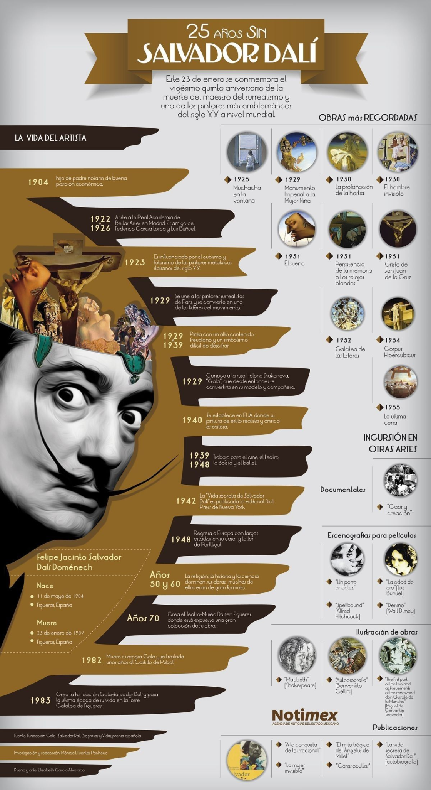

# 案例1｜《萨尔瓦多·达利逝世25周年》信息图分析

> 图形种类：编年图与编目混合型信息图形  
> 五大数据逻辑归属：**编年型（主导逻辑）**  
> 案例图片：参见下方原图（当前图片文件需要重新上传修复）。

## 案例原图

## A 基本的数据逻辑

**主导逻辑是编年型。** 左侧以人物经历为主线，按先后顺序展开，属于单向、不可随意颠倒的顺序排列。右侧补充作品及其他创作领域，采用分组编目的内容组织方式。

辨别时不要把“常用信息图形种类”与“五大数据逻辑”混淆：

- **常用图形种类：** 编年图与编目混合型
- **五大数据逻辑：** 编年型（以生平顺序为主干）
- **辅助组织方式：** 编目／分类资料

## B 统计图形及计算方式

该案例重点使用**顺序节点＋分组图文列表**，并非以数值统计为核心。

- 生平部分：以年份或阶段标记先后关系，按顺序排列。
- 代表作品部分：使用作品缩略图、名称和年份组成图文卡片。
- 其他创作领域：依栏目分类列示内容。

**没有明确数值尺度时，不应把图像面积、节点大小或装饰色块解释为数据比例。**

## C 视觉编码

| 视觉要素 | 承担的信息功能 |
| --- | --- |
| 点／年份标记 | 定位事件或作品 |
| 上下位置与色带 | 辅助识别人物生平的先后顺序 |
| 栏目／分隔线／留白 | 表明作品类别及条目的归属 |
| 图像缩略图 | 帮助识别作品对象 |
| 字体字号与字重 | 区分主题、栏目及条目 |
| 色彩 | 强调信息、组织版面，不默认代表定量数值 |

## D 数据／信息架构

画面按**总主题 → 主干经历＋分类作品资料**展开：

1. 总主题：达利逝世25周年。
2. 左侧：按年份组织的生平经历，提供主线。
3. 右上：代表作品，以作品名、图像及年份补充说明。
4. 右下：其他艺术和出版物等栏目，按类别组织条目。

对应的基础数据可以拆为两张表：

| 生平表：年份 | 事件 |
| --- | --- |
| 顺序键 | 事件文字 |

| 作品表：类别 | 作品名称 | 创作年份（如有） |
| --- | --- | --- |
| 类别标签 | 作品条目 | 年份 |

## E 视觉叙事架构

**双路线阅读：** 以“逝世25周年”的总标题引入，左侧顺读人物经历，右侧按作品类别跳读。顺序主线交代“如何发展”，编目栏目交代“有哪些内容”。

## 一句话判断

**编年型作主干，编目内容作补充；表现形式是编年图与编目混合型，五大数据逻辑归入编年型。**

---
说明：此文整理自此前对该案例的讨论。图片已使用同目录相对路径引用；仓库内现有图片文件大小异常（仅 2 字节），需以正确的 PNG 原文件替换后才能正常显示。
