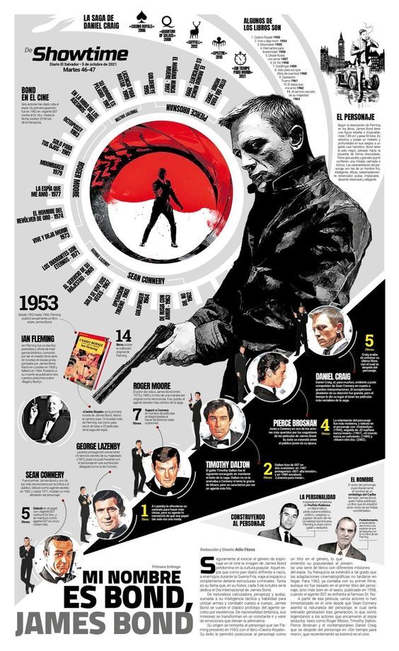

# 案例2｜《MI NOMBRE ES BOND, JAMES BOND》007系列电影信息图分析

> **17种常用信息图形类型：编年图与编目混合型信息图形。**  
> **五大数据架构逻辑：编目型（编年主干＋层级内容）。**  
> 判断针对图中实际的信息组织与阅读机制，不把“大量文字／肖像／圆环”直接等同于层级型，也不把视觉装饰当作数量刻度。

## 类型判定与边界

作品以詹姆斯·邦德系列为总主题：上部围绕枪管视觉母题环形列示电影名称、年份与人物背景；下部黑色斜向区域依照演员更替的先后组织主要扮演者，每位演员配有头像、片数及介绍。这同时满足：

1. **顺序主干**：系列发展的演员阶段有先后，随意打乱会破坏“历代邦德”的发展叙述。
2. **下属内容**：演员阶段关联其参演影片等可独立列项的作品记录，不只是演员头像或简单说明；作品名、上映年份等是作品属性。
3. **阅读结构**：以演进顺序串联人物档案，读者能沿主线阅读，也能进入某演员的电影清单检索。

**为什么不优先判为17种中的“层级型”？** 单论“007系列→演员→影片”，它确实具有层级；但整版不仅解释包含关系，还通过演员接力及发展年份组织历史叙事。纯层级型允许兄弟分支相对自由地排列，本图演员顺序不能任意置换而不改变叙述含义。因此以**编年图与编目混合型**作为更能描述总体目的的表现类型，**层级型**作为局部结构特征保留。需要注意：这并不是一张采用等比例年份刻度的标准时间轴，历史顺序主要由内容和节点次序表达。

## A｜基本的数据逻辑

**五大类型之一：编目型（编年主干＋层级内容）**。

- **有序性／单向性／不可任意颠倒**：原著起源、演员更替与系列发展具有历史先后；下方沿斜向连续排列的演员构成可循的顺序线索。
- **真实层级归属**：总体系列 → 参演演员阶段 → 对应电影作品；演员与各片的关联可落到数据行，且各作品有名称和年份等属性。
- **多维并置**：同一演员可对应姓名、出演作品、数量和简介；电影可对应片名和上映年。辅助区有原著作者 Ian Fleming、小说与角色背景等独立语境。
- **双重索引**：既可按演员发展顺序定位，也可按演员查影片；“环形”是分组排布，不自动构成数值的百分比。
- **限制条件**：不能仅把“人物旁边有文字”当作层级证据；判定成立依靠演员与独立作品记录之间可核对的一对多关联。

**简式结构：** 007系列 → 按先后排列的演员阶段 → 各阶段关联的电影作品 → 每部作品的年份等属性。

## B｜统计图形、统计方式与计算方式

| 画面位置 | 图形／组织方式 | 处理逻辑 | 是否严格的定量图表 |
| --- | --- | --- | --- |
| 上部环形电影分组 | 径向分组目录／环状标签布局（近似旭日图的层次组织观感） | 按演员或影片条目分类、排序，环绕主题排布 | **否**；无明确角度、半径或面积的数量比例尺 |
| 下部斜向演员链 | 顺序节点／人物接力式排列 | 按演员登场先后排序，建立人物与作品对应关系 | 主要编码**先后**，不是连续时间尺度 |
| 肖像旁的醒目数字 | 数值标签 | 对演员关联的电影做分类计数：`COUNT(作品ID)`，需保证不重复计数 | 数字本身为定量统计，肖像面积不是 |
| 1953等年份与出版资料 | 历史年份、总量注记 | 记录年份、按类别汇总作品或出版资料 | 主要为文字标注，并非可比较的坐标图 |
| 电影名和简介 | 分类索引＋文本信息 | 按组关联影片名称、年份、人物描述 | 否 |

**RAWGraphs 对照：** 若将“演员 → 电影”按层级字段输入，RAWGraphs 的 **Sunburst Diagram（旭日图）**可作为重新制图时的候选；但原图更接近**自定义环状分类目录**，不能直接说它使用了标准旭日图，更不能臆测圆弧长度代表影片数。若要定量比较演员参演数量，可另用 **Bar Chart（条形图）**：`演员`分组、`COUNT(影片ID)`计算长度，原图并没有真正画出这样的条形图。

**计算流程：** 整理电影记录 → 关联演员 → 以实际出演口径去重 → 分组计数 → 按发展先后排序 → 配合演员与作品标签排版。

## C｜视觉编码

| 视觉维度 | 图中体现 | 编码作用 |
| --- | --- | --- |
| **点** | 圆形演员肖像、局部标记 | 代表演员身份与发展节点 |
| **线** | 斜向白色分界、圆环弧线、细虚线引导 | 斜向结构暗示推进方向；环线划分作品组；虚线连接说明 |
| **面** | 大面积黑白分区、灰色环带、红色枪管圆形 | 建立主线与背景信息区；突出主题焦点 |
| **体** | 大幅黑白写实肖像的明暗与空间遮挡 | 提升画面冲击和人物辨识；不以体积表示数值 |
| **符号／图像** | 邦德枪管、持枪人物剪影、演员照片及电影相关小图 | 表示电影主题、人物身份和文化语境 |
| **色彩** | 黑白灰为基础；红色强调枪管视觉；黄色强调数字 | 用少量高对比色使重要主题与片数跃出 |
| **字体** | 粗重紧缩标题字、人物姓名、片名、数字、较小段落字 | 建立主题→分组→记录→注释的阅读层次 |
| **版式** | 上方环形索引、中部巨幅 Daniel Craig 肖像、下部斜向演员链、底部大标题 | 由中心视线焦点引向历代演员及扩展文字 |
| **图译／标注** | 人像直接辨认演员，片名及年份为文本标签，黄色数字标识片数 | 把类别、关系和计数分别映射为肖像、位置及数字 |

**注意：** 颜色、圆环面积、人物大小主要是视觉强调，并无充分证据表明与电影数量成比例。视觉中下方斜坡也不是“出演数量走势图”。

## D｜数据／信息架构

**整体信息树：**
- 主题层：James Bond／007系列。
- 顺序主干层：原著起点及演员演进阶段（以出演时期排序）。
- 分支层：各演员及其相应电影作品记录（可独立检索）。
- 属性层：电影名、上映年份、参演片数、人物简介。
- 背景辅助层：Ian Fleming 原著、小说出版及邦德角色背景（与电影数据口径分离）。

**建议拆成互相关联的数据表，避免把电影与小说混算：**

**演员阶段表（每位演员一行）**

| 演员ID | 演员姓名 | 阶段顺序键 | 人物简介 |
| --- | --- | ---: | --- |
| A01 | 演员甲 | 1 | … |
| A02 | 演员乙 | 2 | … |

**电影作品表（每部电影一行）**

| 作品ID | 电影名称 | 上映年份 | 演员ID |
| --- | --- | ---: | --- |
| F01 | 作品甲 | … | A01 |
| F02 | 作品乙 | … | A01 |
| F03 | 作品丙 | … | A02 |

演员片数由作品表按演员分组计数得到；小说原著另建资料表。若需表达跨演员的作品或非标准出演关系，可建演员—作品关联表，不强行规定一部作品只能归一个演员。

**架构要点：** `演员阶段顺序键`表达编年顺序，`作品.演员ID`表达父子／归属关系，二者共同支撑编目型，而画面中的肖像大小和标题字号都不属于主键。

## E｜视觉叙事架构

**主叙事：系列起源 → 作品总览 → 历代演员接力 → 角色及原著背景补充。**

1. **吸引注意**：红色枪管视觉与巨幅 Daniel Craig 肖像首先建立“007／邦德”主题。
2. **建立整体印象**：环形的影片名称与年份让读者感知系列规模和演进跨度。
3. **沿线追溯**：读者顺着黑色斜向区域的演员头像，看到历任邦德的更替及出演数量。
4. **分支检索**：通过演员姓名、图片及引导线，查找每位演员的相关影片和说明。
5. **扩展语境**：底部大标题与 Ian Fleming、角色介绍等文字模块补充文化和创作背景。

**双层阅读：** 宏观沿“历史发展”依次阅读；微观可随时跳转至任一演员和作品模块。视觉注意力路径并非严格等于历史发生顺序。

## 与17种“层级型”的区别与复用判断

| 维度 | 纯层级型信息图形 | 本案例 |
| --- | --- | --- |
| 主要回答 | 谁包含谁、哪些子类属于哪个上级 | 谁先谁后，以及每位演员关联哪些作品 |
| 分支排序 | 同级分支通常可以换位，不影响归属 | 演员演进的顺序是叙事要点 |
| 结构核心 | 父子关系 | **编年主干＋作品层级** |
| 视觉特点 | 分层、嵌套、树形或类别组 | 环形归档＋斜向演员发展序列 |

**最终归类：五大数据逻辑＝编目型；17种图形类型＝编年图与编目混合型；局部层级型特征明确，但不是整版唯一或主导的组织方式。**

---

**可复用规则：** 观察是否有一条**不能任意颠倒的顺序主干**，并且每一主干节点是否包含**可独立列行、拥有明确归属的下级项目**。两者兼有时可判编目型；再按整版的表达目的、主次结构及阅读机制判断17种视觉表现类型。
