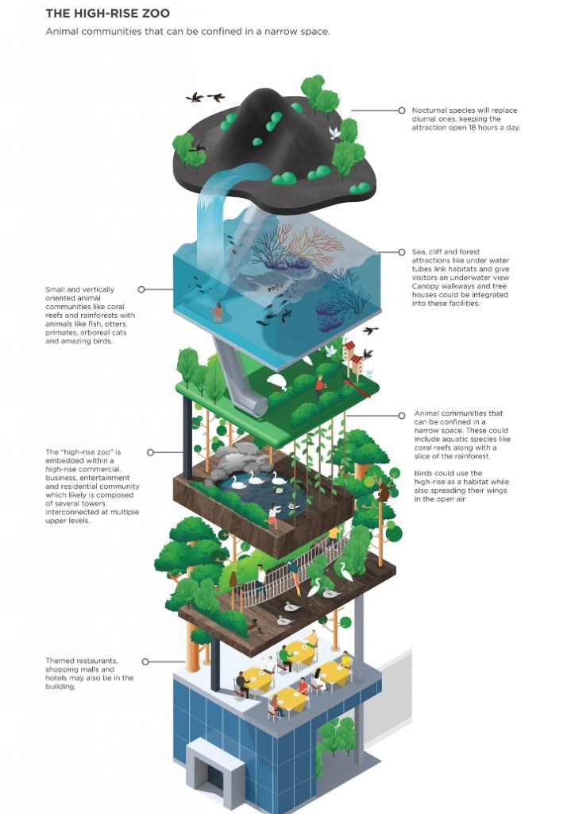

# 3D-01 高层动物园

课件第 38 页。图题或图中标识 *The High-Rise Zoo*。

## 数据与信息组织

以一栋垂直建筑为主题，将动物栖息场景和服务设施分布在不同楼层。

## 图形与视觉编码

等轴爆炸图拉开楼层，材质和色彩区分水域、陆地和建筑空间，引线将各层与文字配对。

## 阅读路径与复用

先读整栋建筑的叠层，再从某层向两侧查阅功能说明。楼层间距由展示需要决定。

[返回本组案例](README.md)
