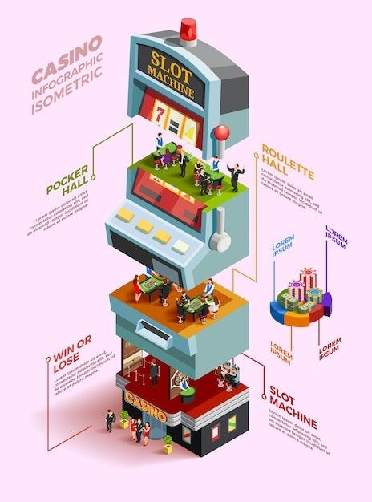

# 3D-02 老虎机空间拆分

课件第 38 页。图题或图中标识 *Casino Infographic Isometric*。

## 数据与信息组织

老虎机的层叠部件内布置扑克区、轮盘区等场景，右侧另有小型立体标注。

## 图形与视觉编码

等轴视角、台面轮廓和彩色分区把场景装入共同主体，各标签通过折线回指。

## 阅读路径与复用

从整体机器入口认出主题，再逐层查看模块。右侧占位文字对应的示意视图适合讨论造型和标注方法。

[返回本组案例](README.md)
