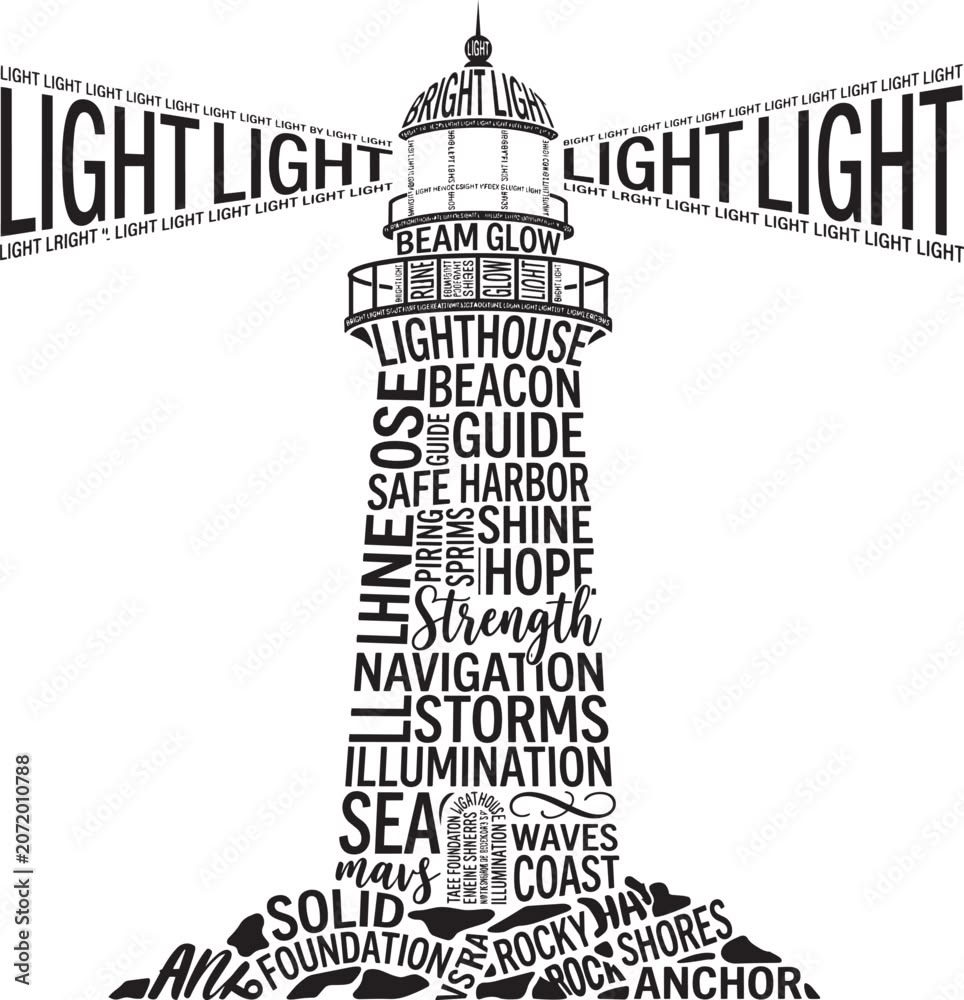

# 案例1分析｜灯塔造型词云（Lighthouse Word Cloud）

> **五大数据架构逻辑**：字母表型（扩展意义：独立、平行、同构、可重排的词语单元），而非严格按 A–Z 检索的字母索引。  
> **常用信息图形种类**：17-词云图信息图形（Word Cloud），具体为具象轮廓式／造型词云（Shape Word Cloud）。  
> **统计图形对应**：词云／Tag Cloud；在 RAWGraphs 中可通过自定义 Tag Cloud 图表表达词语权重与字号映射，但原图的灯塔轮廓还需要定制布局。  
> **图像来源线索**：用户提供的案例原图，图中可见 Adobe Stock 水印和编号 #2072010788。此图片为带水印的原图，未据此推断设计作者、原始词频或量化数据。

## 基本分类与归类理由

- **为什么属于字母表型（五大数据逻辑）？** LIGHT、BEACON、GUIDE、HOPE、SEA、FOUNDATION 等关键词是可以独立记录、平行展示和重排的文本单元，不存在必须保留的事件先后、严格父子关系或地理位置关系。本判断采用本仓库对字母表型的**扁平独立同构数据单元**的扩展定义，并非认定画面采用了字母顺序索引。
- **为什么属于词云图（常用表现类型）？** 以词语为主要可见图元，利用大小、字重、方向、疏密和位置变化填充预设的灯塔、光束及岩石轮廓；图像本身由文字构成，不是用文字注释一张普通插画。
- **为什么不属于层级型？** 大小字号、顶部到底部的空间排列和视觉主次，不等于数据单元之间具有上下级从属关系。
- **数据可视化属性的边界**：原图没有展示频次、权重、比例、图例或量化尺度，因此不能将字号直接认定为词频大小。它更偏向**概念表达与文字造型设计**，而非可精确读数的统计词云。

## A｜基本的数据逻辑

**独立文本单元 → 共同语义主题 → 可选语义／权重属性 → 无固定先后重排 → 轮廓约束布局。**

| 判断维度 | 该案例特征 |
| --- | --- |
| 最小数据单元 | 一个英文词语或短语 |
| 数据类型 | 主要是定性文本；如另有权重、频次，才增加定量字段 |
| 组织关系 | 独立、平行、同构、可重排、语义关联 |
| 顺序性 | 无必须遵守的单向顺序，阅读可以跳转 |
| 层级性 | 不具备严格父子关系；视觉大小差别不自动构成层级 |
| 空间性 | 灯塔外轮廓是后期排版约束，不是地理空间关系 |
| 主题关联 | 光亮、导航、希望、海洋、岸边、稳固等关键词共同描述灯塔 |

**通用数据规律**：同一主题下的多个关键词可以分别成为一行记录，拥有相同字段，但单元之间不依赖固定前后位置才能成立。

## B｜统计图形、统计方式与计算方式

**对应类型：词云图（Word Cloud / Tag Cloud），具体采用轮廓造型词云。**

| 统计或布局环节 | 计算／表达方式 | 该原图能否确认 |
| --- | --- | --- |
| 词语提取 | 从文本提取词语，或人工选取与主题相关的词语 | 可确认画面有关键词，无法确认提取方法 |
| 词频统计（可选） | 对某词语计数，记为 nᵢ；相对词频 fᵢ = nᵢ / Σnⱼ | 原图没有频数，**不能确认做过词频统计** |
| 语义／重要度赋权（可选） | 给词语分配权重 wᵢ，可根据词频或人工语义优先级得到 | 原图没有权重说明，不能确认权重口径 |
| 视觉尺度映射（可选） | 将 wᵢ 映射为字号 sᵢ，例如线性缩放到最小与最大字号 | 只能观察字号差异，不能反推出数值 |
| 文字排版 | 旋转、压缩间距、调整长度，避免重叠并填满目标区域 | 可以确认存在尺寸、方向、疏密变化 |
| 外形约束 | 将文字安放在灯塔塔顶、塔身、光束和岩石轮廓内 | 原图明确可见，属于造型布局 |

**与 RAWGraphs 的对应关系**：可参考自定义的 **Tag Cloud for RAWGraphs**（https://github.com/rawgraphs/rawgraphs-chart-tagcloud）来完成“词语 + 数值权重 → 字号／色彩”的基础词云表达。它是**可加载的自定义图表**，不能不加说明地称作 RAWGraphs 内置原生图表；原图的灯塔造型与弯曲排版还需使用形状掩模、矢量编辑或自定义布局实现。

**特别注意**：画面中 LIGHT 在两侧光束中多次出现，属于视觉重复。没有源数据时，不能直接把这种出现次数解释为文本语料中的真实词频。

## C｜视觉编码

| 编码要素 | 图中表现 | 作用与限制 |
| --- | --- | --- |
| 点 | 无作为独立观测值的点 | 不承担散点或点数统计 |
| 线 | 光束方向的字列、塔顶放射形、弧线形平台边缘 | 表现光线延伸、导向与结构线 |
| 面 | 密集文字填充塔身、灯室、塔基和岩石区域 | 通过字形的黑色集合形成具象剪影 |
| 体 | 弧形边缘及文字透视暗示圆形灯室和塔身 | 只是空间感，并非三维量值编码 |
| 符号 | 灯塔、光束、岩石、海浪的整体形态 | 承载“指引、希望、航行、坚固”的主题隐喻 |
| 色彩 | 黑色文字 + 白色背景，局部灰色水印来自原图来源 | 高反差强化剪影轮廓；颜色没有显式的数据分类映射 |
| 字号／字重 | LIGHT、SEA、NAVIGATION 等较大，其余词语大小不一 | 建立阅读重点、适配形状；**不能直接当作数量大小** |
| 方向／位置 | 水平、垂直、倾斜和曲线方向混排 | 填充不规则区域并暗示建筑结构 |

**字体系统**：大写粗体无衬线字为主体，穿插如 Strength、may 等手写／连笔字，形成刚硬与柔和的节奏对比；字宽、字号和字距均参与造型。

**版式系统**：中轴对称，灯塔位于中央并向上收束；两侧横向发散的 LIGHT 构成光束；底部岩石用大词和不规则字行扩大视觉支撑面。

**辅助形态／图译系统**：词语不仅是标签，本身就是组成灯塔、灯光、岩石形态的材料；把文字意义转化为视觉形状，使观众先认出“灯塔”，再解读内部词语。

**编码总式**：词语内容 → 字体、字号、字重、方向、位置、疏密 → 灯塔具象轮廓。若将来有真实词频数据，才能额外建立“词频 → 字号”的严格量化映射。

## D｜数据／信息架构

**底层：扁平关键词表（每一行一个词语；表内字段一致，不形成树状数据关系）。**

| 关键词 | 语义类别（示意） | 视觉区域（观察） | 权重（如需制作时添加） |
| --- | --- | --- | --- |
| LIGHT | 光亮 | 左右光束、塔顶部 | 待定义 |
| BEACON | 指引 | 塔身上段 | 待定义 |
| GUIDE | 指引 | 塔身 | 待定义 |
| HOPE | 希望 | 塔身 | 待定义 |
| NAVIGATION | 航行 | 塔身 | 待定义 |
| SEA | 环境 | 塔身下部 | 待定义 |
| FOUNDATION | 稳固 | 岩石基座 | 待定义 |

*说明：语义分类是为了说明可复用字段而归纳的示意；原图没有提供这一分类的数据文件。上表不含臆造的频次或权重值。*

- **数据基础层**：关键词与可选的频次、类别、权重。
- **主题组织层**：灯塔及其光亮、指引、希望、环境、稳固等语义集合。
- **视觉空间层**：将关键词分配到顶部灯光、两侧光束、塔身、底部岩石等造型区域。
- **说明层**：除文字本身外，无完整图例或统计口径。

**Excel 形式**：多行 × 至少一列“关键词”；便于复用时建议四列“关键词｜语义类别｜权重（可选）｜布局区域”。这里的空间区域不是数据父节点，是绘制时的视觉位置属性。

## E｜视觉叙事架构

**整体轮廓吸引 → 光束建立主题 → 塔身关键词补充语义 → 底部词语深化隐喻。**

1. **整体识别**：观众先从中央塔身与两侧光束构成的剪影认出灯塔，获得直观主题。
2. **主概念聚焦**：两侧大号 LIGHT 与灯室附近 BRIGHT LIGHT、BEAM、GLOW 迅速强调“发光”。
3. **语义扩展**：塔身中的 LIGHTHOUSE、BEACON、GUIDE、SAFE HARBOR、SHINE、HOPE、NAVIGATION 等词强化“导航、保护、希望”的联想。
4. **场景建立**：SEA、WAVES、COAST、STORMS 等词构建海洋与风暴环境。
5. **隐喻收束**：SOLID、FOUNDATION、ROCK、ANCHOR 等底部词汇用“坚固根基”的概念支撑灯塔象征。

**叙事方式**：图像先于细读、主题先于细节、非线性跳读。上述顺序是画面可能引导的注意力路径，**不是按时间或层级进行的强制阅读顺序**。

## 可迁移的判断规则

- 若词语彼此独立、没有强制顺序和父子数据关系，可按照本仓库的**扩展字母表型**判断基础数据逻辑；但若存在 A–Z 检索键，则应进一步说明是**字母索引型**。
- 若文字是构成画面主体的可视元素，且通过大小、方向和布局表达整体形象，可归为词云图；若填充预设对象的剪影，则归为**具象轮廓式词云**。
- 若原图未给出频次、权重、图例及映射规则，应明确它是“词云视觉表达”，不能声称进行了可验证的词频统计。

**一句话结论**：字母表型（独立、同构、可重排）的关键词集合，经文字大小、字重、方向与位置的视觉组织，形成以灯塔轮廓讲述“光亮、指引、希望”的具象造型词云。
