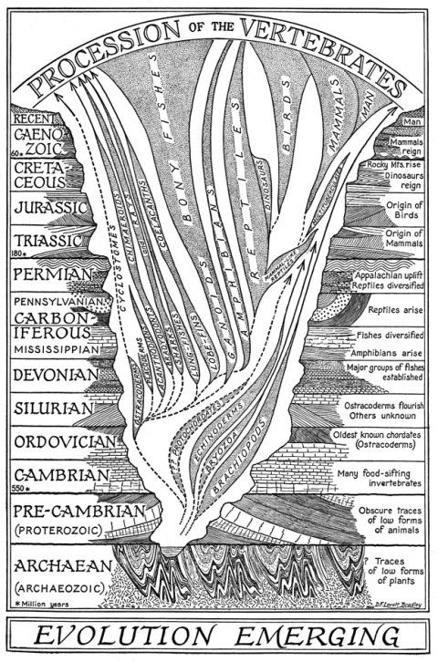
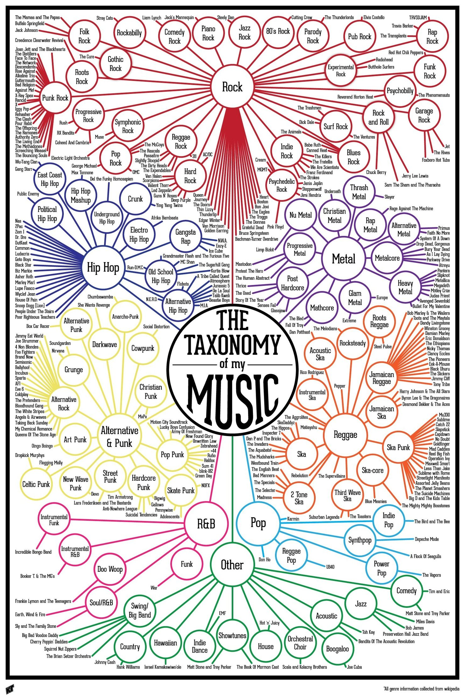
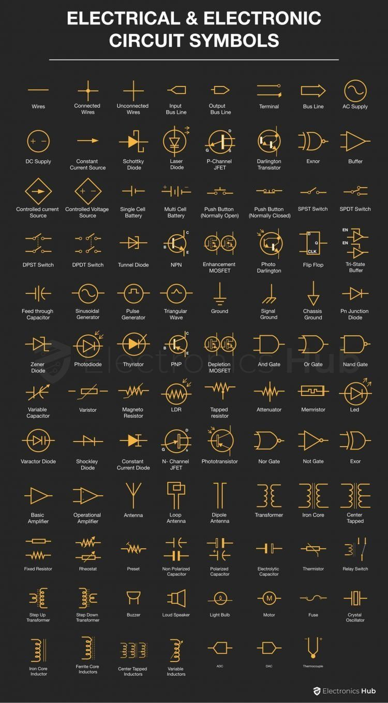
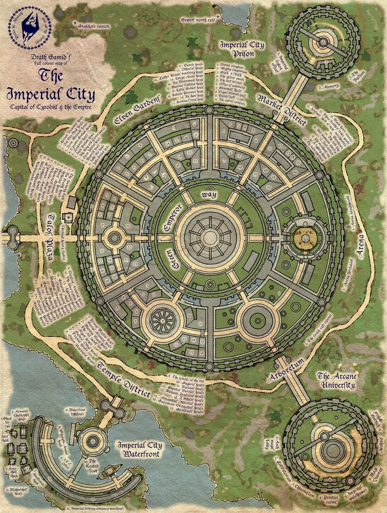
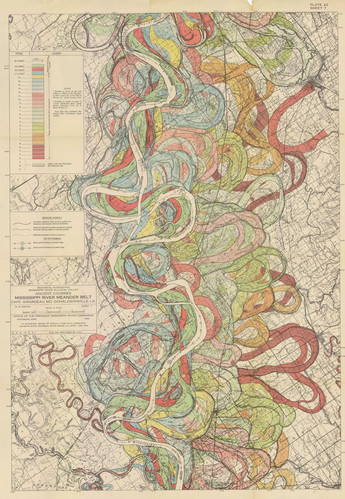
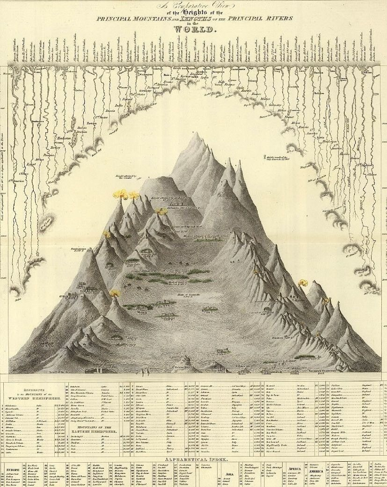

# 课件案例索引

原图摘自本课程课件《信息图表与数据可视化-3(1).pptx》，以下页码以幻灯片顺序为准。图名与署名按课件或原图可辨信息记载。点击缩图可打开图像。

| 常用图形形式 | 文档 |
| --- | --- |
| 混合型 | [四栏综合信息图与 ISOTYPE 示例](01-混合型信息图形.md) |
| 文字型与列表型 | [报纸文章和 The Beatles 专题](02-文字型与列表型信息图形.md) |
| 时间轴型 | [包豪斯、Gear Timeline 和折返版面](03-时间轴型信息图形.md) |

## 五类数据架构的补充案例

| 数据架构 | 对照原图 |
| --- | --- |
| [编年型](../01-信息图形数据逻辑/01-编年型信息图形概念定义.md) | [三份顺序叙事原图](03-时间轴型信息图形.md) |
| [层级型](../01-信息图形数据逻辑/02-层级型信息图形概念定义.md) | [脊椎动物谱系](#da-01-脊椎动物谱系)、[需求金字塔](#da-02-需求金字塔) |
| [编目型](../01-信息图形数据逻辑/03-编目型信息图形概念定义.md) | [音乐流派目录](#da-03-音乐流派目录)、[乐队主题目录](02-文字型与列表型信息图形.md#il-02-los-cuatro-genios-the-beatles) |
| [字母表型](../01-信息图形数据逻辑/04-字母表型信息图形概念定义.md) | [健康生活 A–Z](#da-04-健康生活-az)、[电子电路符号表](#da-05-电子电路符号表) |
| [地理图形](../01-信息图形数据逻辑/05-地理图形信息图形概念定义.md) | [帝都地图](#da-06-帝都地图)、[密西西比河历史河道](#da-07-密西西比河历史河道)、[世界山脉与河流比较](#da-08-世界山脉与河流比较) |

## DA-01 脊椎动物谱系

课件第 6 页，标注为威廉·金·格雷戈里（William King Gregory）两卷本《进化论的出现》的卷首插画。原图题名 *Procession of the Vertebrates*。

底部汇集较早的来源，向上形成多支谱系。左侧的地质时代标注提供另一条顺序线索。沿某条分支可读谱系归属，横向在相近高度对照可看同一阶段的不同支系。图里有年代基准，谱系线宽的数量含义需由图例确认。

## DA-02 需求金字塔

课件第 2 页，图题 *Maslow’s Hierarchy of Needs*。这是课件中的四层版式模板。

竖直位置和分隔线编码层级，层内小图标帮助扫读，下方四组文本用同一编号回指对应层级。金字塔自然变宽，图中无面积量表，分析时据此识别层次编码。四层是图中模板分组的观察结果。

## DA-03 音乐流派目录

课件第 13 页，图题 *The Taxonomy of my Music*。

由中心主题进入 Rock、Hip Hop、Metal 等彩色大组，再沿连线找子类和更细的名称。颜色让多个类别并列可辨，连线则使局部分类具有上下层关系。图可同时读作按类别查阅的目录和由大类展开的层级关系。

## DA-04 健康生活 A–Z

课件第 2 页，图题 *The ABCs of Living a Healthy Life*。

A–Z 作索引键，采用统一网格，每格按字母、插画、简短建议的顺序呈现。读者可以扫完整列，也可以按某个字母直接找条目。主图的字母次序是检索约定。

## DA-05 电子电路符号表

课件第 14 页右图，图题 *Electrical & Electronic Circuit Symbols*，原图底部署名 Electronics Hub。

每格由符号与英文名称构成。形状提供识别线索，网格和一致的符号位置帮助查找。可以按形状找名称，也可以从名称回查符号。图中未采用 A–Z 顺序，因此适合对照字母表型中的「索引」功能。

## DA-06 帝都地图

课件第 17 页，图题 *The Imperial City*。

道路、城墙和水面形成空间框架。中心区、环状街区和外围地点的位置支持方位识别及路线查找。图中几何位置承载地理关系，对地标的说明放在相邻区域。

## DA-07 密西西比河历史河道

课件第 20 页左图，图上可见 *Ancient Courses, Mississippi River Meander Belt*。

多种颜色勾画河道曲流带，现有底图提供对照位置，图例说明颜色与类别的对应。读者先认清河谷范围，再在局部看不同河道怎样叠合。若要重建源数据，需分别记录河道标识、可核实的时期或组别，以及空间几何。

## DA-08 世界山脉与河流比较

课件第 18 页左图，标题标明比较世界主要山脉高度与河流长度。

画面将各地山峰排进对比高度的视图，将河流从上部基线排下以便比较长度。读图可结合相应标尺、项目名和底部表格。此案例的地理对象按测量指标重新布置，位置首先服务于比较。

## 增补案例

复用本页「案例编号、课件页码或来源、原图、关键组织关系、统计和编码观察」的记录方式。同一案例支持多种读法时，从涉及的概念文档分别建立段落链接。更新原则时，在概念页指出哪条新证据改变了判断。
